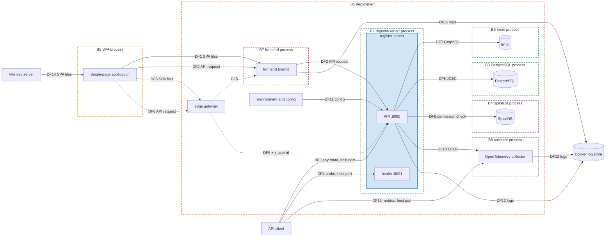

# Threat Model — Application

This model covers the parts of register that run in every deployment: the
server, the single-page application, the frontend's nginx, and the two stores.
It holds every threat that does not depend on how the system is deployed. Four
deployment models build on it, and each lists only what its deployment adds:

| Deployment id | Deployment | Auth mode |
|---|---|---|
| `compose-inmem` | Docker Compose, no `persistence` profile | `capability-only` |
| `compose-persistent` | Docker Compose with the `persistence` profile | `capability-only` |
| `k3d-L1` | k3d cluster, Layer 1 | `identity` |
| `k3d-L2` | k3d cluster, Layer 2 | `fine-grained` |

How the model is built, and what its terms and diagram conventions mean, is in
[TM-METHODOLOGY-CONCEPTS.md](TM-METHODOLOGY-CONCEPTS.md). Assumptions and
observations about single components are in
[APPLICATION-TM-NOTE.md](APPLICATION-TM-NOTE.md).

The model describes the system at the version stated above the diagram in §3.
A control that does not exist yet appears as a mitigation with status `open`,
never as a boundary.

The auth mode is `register.auth.mode` in
[application.conf](../../../modules/server/src/main/resources/application.conf).
Compose does not set `REGISTER_AUTH_MODE`, so both compose deployments run the
default, `capability-only`. The layers are defined in
[AUTHORIZATION-PLAN.md](../plans/AUTHORIZATION-PLAN.md).

---

## 1. Schema

Each threat is one YAML block under its own heading, and the heading repeats
`id` and `label`. A deployment model refers to a threat here by its `id`.

```yaml
# Fields per threat entry:
#   id              - stable identifier, never renamed. T1–T4 keep the ids they
#                     have in THREAT-CATALOG-(INCOMPLETE).md; new threats continue
#                     from T5.
#   label           - name of the threat, the same as its section heading
#   stride          - list; each one of: spoofing | tampering | repudiation |
#                     information-disclosure | denial-of-service |
#                     elevation-of-privilege
#   flow            - id of the data flow the threat acts on (§2.5), or null
#                     for a threat against an element itself
#   element         - name of the element the threat acts on (§2.1), or null
#                     for a threat against a data flow
#   statement       - one sentence: "A <threat source> with <prerequisites> can
#                     <threat action>, which leads to <threat impact>, negatively
#                     impacting <impacted assets>."
#   invariant       - the condition that must hold, stated positively
#   failure_mode    - what happens when the invariant does not hold
#   mitigations     - ordered list; each item has:
#                       control         - what the control does
#                       adr             - the decision record and section that
#                                         require it, or null
#                       implemented_in  - repository-relative path of the code or
#                                         manifest that implements it, or null
#                                         while the control does not exist
#                       test            - repository-relative path of the test
#                                         that proves it, or null
#   status          - map from every deployment id to one of:
#                       mitigated-tested   - a control exists and a test proves it
#                       mitigated-untested - a control exists and no test proves it
#                       accepted           - left open on purpose; `adr` of a
#                                            mitigation names the record saying so
#                       open               - no control exists
#                       not-applicable     - the deployment has no element the
#                                            threat needs
#   related_code    - list of repository-relative paths directly involved
#   todo            - outstanding work, or null
```

A path in another repository is written with that repository's name first, for
example `register-infra/infra/k8s/gateway/clienttrafficpolicy.yaml`.

---

## 2. Inventory

### 2.1 Elements

| Element | What it is | Where it runs |
|---|---|---|
| Single-page application | Scala.js and Laminar, served as static files | the user's browser |
| frontend | nginx. Serves the SPA files and `/config.json`, and in compose passes API requests on to register-server | `frontend` profile in compose; a pod in k3d |
| register-server | The ZIO, Tapir and zio-http backend, compiled as a GraalVM native image | always |
| Irmin | Content-addressed store for risk trees and their history, read and written over GraphQL | `persistence` profile in compose; a pod in k3d |
| PostgreSQL | Workspace records: the key's SHA-256 hash and the workspace's trees | `persistence` profile in compose; a pod in k3d |
| OpenTelemetry collector | Receives the server's spans and metrics over OTLP. Its `debug` exporter prints traces and metrics to its stdout, and its `prometheus` exporter serves metrics on port 8889 | `observability` profile in compose |
| Vite dev server | Serves the SPA files on host port 5173 during frontend development. It has no proxy, so the SPA calls register-server on port 8090 directly | a host process, in the compose workflow without the `frontend` profile |
| API client | Any HTTP client on the host or on a network that reaches it | outside the deployment |
| edge gateway | Envoy Gateway. Its elements and controls are in the k3d models | k3d |
| Docker host and daemon | Runs every container. Holds their environment, volumes and logs, and can exec into any container | the host |
| Docker log store | The daemon's store of each container's stdout and stderr, read with `docker logs` | the host |

Without the `persistence` profile, register-server keeps trees and workspaces
in its own memory, and Irmin and PostgreSQL do not run.

### 2.2 Assets

| Asset | Why it matters | Where it is defined |
|---|---|---|
| Workspace key (`WorkspaceKeySecret`) | A **secret**: holding it is permission to use the workspace. 128 bits from `SecureRandom`, base64url-encoded to 22 characters. Only its SHA-256 hash is stored | ADR-021 §1–2, ADR-022, [TERMINOLOGY.md](../../user/TERMINOLOGY.md) §8.2 |
| Risk trees, their history and their scenarios | The customer's risk analysis | ADR-017, ADR-021 |
| Simulation results: loss exceedance curves and cached values | Derived from the risk trees, and as confidential as they are | no record classifies them |
| Confidential identifier (workspace identifier) | Holding it grants nothing. It never crosses to the client | ADR-036, [TERMINOLOGY.md](../../user/TERMINOLOGY.md) §8.3, §8.7 |
| Resource names (tree, node and mitigation identifiers) | Cross to the client in both directions, and may appear in a server log | [TERMINOLOGY.md](../../user/TERMINOLOGY.md) §8.4, §8.7 |
| Database credentials | `REGISTER_DB_USER` and `REGISTER_DB_PASSWORD` | ADR-022 |
| SpiceDB token (`SPICEDB_TOKEN`) | Read only in `fine-grained` mode | ADR-022, AUTHORIZATION-PLAN L2.2 |
| User identity (`x-user-id`) | Decoded into `UserId.Authenticated`. In `identity` and `fine-grained` mode the application reads it as already validated by the edge | ADR-012 §7 |
| Container logs | Hold whatever each container writes to stdout and stderr. ADR-022: "Secrets must never appear in logs or error messages" | ADR-022 |
| Docker volumes `irmin-data` and `pg-data` | Hold the risk trees and the workspace records at rest, unencrypted, readable from the host | [docker-compose.yml](../../../docker-compose.yml) |
| Simulation capacity | register-server's CPU and memory. Bounded by `maxConcurrentSimulations` (4), `maxRequestBytes` (8 MiB) and the container's limits of 2 CPUs and 256 MiB | `application.conf`, `docker-compose.yml` |

### 2.3 Entry points

The routes come from the endpoint definitions in
`modules/common/src/main/scala/com/risquanter/register/http/endpoints/` and from
`HealthProbeServer`.

| Route | Credential the application checks | Source |
|---|---|---|
| `POST /workspaces` | none. It creates the credential | `WorkspaceLifecycleEndpoints.bootstrapWorkspaceEndpoint` |
| `/w/{key}/...`: trees, history, revert, structure, changed nodes, analysis, query, scenarios, rotate, delete | the workspace key in the path. `x-user-id` is read as an optional header | `BaseEndpoint.authedBaseEndpoint`, `BaseEndpoint.workspaceRoute` |
| `POST /distribution/preview` | none | `DistributionPreviewEndpoints` |
| `DELETE /admin/workspaces/expired` | none in the application. The controller takes the system maintenance token, and the edge decides who can reach the route | `WorkspaceLifecycleController.evictExpired`; AUTHORIZATION-PLAN L1.5 |
| `GET /health` on port 8090 | none | `SystemEndpoints` |
| `GET /health` and `GET /ready` on port 8091 | none | `HealthProbeServer` |
| `/docs` | none. The Swagger UI | `HttpApi` |

Port 8090 serves the API, and port 8091 serves health probes. The frontend's
nginx passes `/w/*` (unless `Accept` contains `text/html`), `/workspaces`,
`/distribution`, `/health` and `/docs` on to register-server. It does not pass
on `/admin`. The routing is in the nginx template in
[Dockerfile.frontend-prod](../../../containers/prod/Dockerfile.frontend-prod).

### 2.4 Trust boundaries

A trust boundary, in the component sense of
[TM-METHODOLOGY-CONCEPTS.md](TM-METHODOLOGY-CONCEPTS.md) §4, encloses one or
more elements, and a control separates the principals inside it from those
outside. Shostack: "A trust boundary indicates separation of principals by some
control, and the boundary is instantiated by the control." A boundary is drawn
only where its control exists, and boundaries nest. A data flow that crosses a
boundary is where a threat can act.

Every process of the deployment has its own boundary. Its control is process
isolation: in compose, the container's own process, filesystem and namespaces.
Process isolation protects a process's memory and execution. It does not decide
who can call the process's ports. §2.6 records who can.

This model draws only the boundaries whose control is the same in every
deployment where the element exists. A boundary whose control differs between
compose and k3d is drawn in the deployment models. The settings that harden a
container are listed for compose. The k3d settings are in the k3d models.

| Id | Encloses | Control | Where it exists |
|---|---|---|---|
| B1 | The deployment: everything the operator runs | compose: the `register-network` bridge network, opened by every port published on the host. k3d: the cluster network, entered through the edge gateway | all |
| B2 | The register-server process | process isolation. ADR-039 §1: "the trust region is the memory of one process". Compose sets `read_only`, `no-new-privileges`, and limits of 2 CPUs and 256 MiB | all |
| B3 | The PostgreSQL process | process isolation, and password authentication of `REGISTER_DB_USER`. Compose sets no hardening | `compose-persistent`, k3d |
| B4 | The SpiceDB process | process isolation, and the preshared token `SPICEDB_TOKEN` | `k3d-L2` |
| B5 | The single-page application's process in the browser | the browser's process and origin isolation. ADR-039 §1 names it as the second trust region | all |
| B6 | The Irmin process | process isolation. Compose sets `read_only`, `no-new-privileges` and a 10 MiB `/tmp` | `compose-persistent`, k3d |
| B7 | The frontend (nginx) process | process isolation. The image runs as uid 101, and compose sets `read_only` and `no-new-privileges` | `frontend` profile in compose; k3d |
| B8 | The OpenTelemetry collector process | process isolation. Compose sets no hardening | `observability` profile in compose |

B2, B3, B4, B6, B7 and B8 lie inside B1. B5 lies outside B1. The Vite dev
server, the API client, the Docker host and daemon, and the Docker log store are
outside B1. The model takes the Docker host and daemon as trusted
([APPLICATION-TM-NOTE.md](APPLICATION-TM-NOTE.md)).

### 2.5 Data flows

A flow is listed once, in the direction of the request, and its response
travels the same path back. "Ingress point" is the place ADR-039 §1 names where
a value from the flow enters the server process, and is empty for flows that do
not reach it.

| Id | From → to | Carries | Transport | Crosses | Ingress point | Deployments |
|---|---|---|---|---|---|---|
| DF1 | SPA → frontend | requests for the SPA files and `/config.json` | HTTP, host port 18080 | B5, B1, B7 | — | compose |
| DF2 | SPA or API client → frontend → register-server | API requests, workspace key in the path | HTTP, host port 18080, then HTTP on `register-network` | B5, B1, B7, B2 | Tapir codec, JSON decoder, typed claim-header input | compose |
| DF3 | SPA or API client → register-server, host port 8090 | API requests, workspace key in the path, any route including `/admin` | HTTP | B5, B1, B2 | Tapir codec, JSON decoder, typed claim-header input | compose |
| DF4 | any host process → register-server, host port 8091 | health and readiness probes | HTTP | B1, B2 | — | compose |
| DF5 | SPA or API client → edge gateway → frontend | requests for the SPA files and `/config.json`, browser navigation | see the k3d models | B5, B1, B7 | — | k3d |
| DF6 | SPA or API client → edge gateway → register-server | API requests, workspace key in the path; the gateway adds `x-user-id` | see the k3d models | B5, B1, B2 | Tapir codec, JSON decoder, typed claim-header input | k3d |
| DF7 | register-server → Irmin | GraphQL reads and writes of risk trees | HTTP on `register-network` | B2, B6 | the repository's decode of a stored value | `compose-persistent`, k3d |
| DF8 | register-server → PostgreSQL | workspace records | JDBC over TCP. Compose configures no TLS | B2, B3 | the row-to-record conversion | `compose-persistent`, k3d |
| DF9 | register-server → SpiceDB | permission checks | see the k3d models | B2, B4 | the response parse | `k3d-L2` |
| DF10 | register-server → OpenTelemetry collector | spans and metrics | OTLP over gRPC, `http://otel-collector:4317` | B2, B8 | — (outbound only) | when the collector runs |
| DF11 | environment → register-server | configuration and secrets at startup | the process environment, set by Docker from `docker-compose.yml` and the env file | B2 | the config decoder | all |
| DF12 | frontend, register-server and collector → Docker log store | stdout and stderr: nginx's access log in its default `combined` format and its error log, register-server's log, the collector's `debug` exporter output | the Docker daemon | B7, B2, B8, B1 | — | compose |
| DF13 | any host process → OpenTelemetry collector, host ports 8888 and 8889 | metrics reads | HTTP | B1, B8 | — | `observability` profile in compose |
| DF14 | Vite dev server → SPA | the SPA files | HTTP, host port 5173 | B5 | — | compose, without the `frontend` profile |

In compose, a client can send `x-user-id` on DF2 and DF3. The decoder checks
that it is a UUID. In `capability-only` mode only no-op services receive it
(`UserContextExtractor.noOp`, `BootstrapProvisionerNoOp`,
`AuthorizationServiceNoOp`), so it has no effect. In k3d the frontend has no
connection to register-server: the gateway routes API paths to register-server
itself (register-infra `docs/plans/PLAN-EGC-ENVOY-GATEWAY-CLUSTER.md` §3.1).

### 2.6 What each boundary admits

The diagram shows the flows that were designed to cross a boundary. It cannot
show what else the boundary's control lets through. This table records that.
"Admits" is every principal that can get past the control. "Designed crossings"
is the flows of §2.5 that cross it. Where the first is wider than the second,
the difference is reachable without a designed flow, and each such row is a
source of threat entries in §4.

The compose columns are recorded here. The k3d columns belong to the k3d
models, because their controls are the cluster's.

| Boundary | Admits in `compose-inmem` | Admits in `compose-persistent` | Designed crossings | Wider than designed |
|---|---|---|---|---|
| B1 | Anything that reaches the host on a published port: 8090 and 8091 (register-server), 18080 (frontend, `frontend` profile), 4317, 4318, 8888 and 8889 (collector, `observability` profile). The port mappings in [docker-compose.yml](../../../docker-compose.yml) name no host address, so Docker publishes them on every host interface | as `compose-inmem`, plus 9080 (Irmin) and 5432 (PostgreSQL) | DF1, DF2, DF3, DF4, DF12, DF13 | yes. Ports 9080 and 5432 have no designed flow from outside B1, and the collector's ports 4317 and 4318 have none |
| B2 | On 8090, every route from every element of B1 and every host process, including `DELETE /admin/workspaces/expired`, which checks no credential. On 8091, the probe routes | as `compose-inmem` | DF2, DF3, DF4, DF11, DF12 | yes. The `/admin` route has no designed caller outside the operator, and nothing in compose restricts who calls it |
| B3 | — (PostgreSQL does not run) | Every element of B1 and every host process that presents user `register_app` with its password. The password is the fixed value `dev-only-password`, written in `docker-compose.yml` | DF8 | yes. Only register-server is designed to connect, and the password is public in the repository |
| B4 | — (SpiceDB does not run) | — (SpiceDB does not run) | DF9 | — |
| B5 | Scripts and connections from any origin. Neither `modules/app/index.html` nor the frontend's nginx sends a `Content-Security-Policy`. register-server's policy (`default-src 'self'; script-src 'self'; style-src 'self' 'unsafe-inline'; connect-src 'self'`) applies only to responses register-server writes, and the SPA's HTML is not one of them | as `compose-inmem` | DF1, DF2, DF3, DF14 | yes. The SPA is designed to load scripts and call APIs only on its own origin |
| B6 | — (Irmin does not run) | On 8080, every element of B1, with no credential. On host port 9080, every host process | DF7 | yes. Only register-server is designed to call Irmin, and any caller can read and rewrite every risk tree |
| B7 | On 8080, every element of B1. On host port 18080, every host process | as `compose-inmem` | DF1, DF2, DF12 | no. The frontend is the public entry, and every caller it admits is one it is designed to serve |
| B8 | On 4317 and 4318, every element of B1 and every host process, with no credential. On 8888 and 8889, every host process | as `compose-inmem` | DF10, DF12, DF13 | yes. Only register-server is designed to send telemetry, and any caller can send spans and metrics |

---

## 3. Data-flow diagram

Each dashed box is a trust boundary from §2.4, drawn in its own colour, and
each arrow is a data flow from §2.5. Between the client side and the server,
solid arrows are compose flows and dotted arrows are k3d flows. The flows out of
register-server are drawn solid, and the Deployments column of §2.5 says where
each one exists. The solid box inside B2 is the register-server component, and
its two ports are where the flows end. Who can reach a process without a drawn
flow is read from §2.6.

**System version:** 0.24.9



The API client also sends DF2 and DF6. Those arrows are left out to keep the
diagram readable. The deployment models draw only the elements and flows of
their own deployment.

---

## 4. Threats

The STRIDE pass over the elements in §2.1, the flows in §2.5 and the rows of
§2.6 marked "wider than designed" has not been run yet. T5 is recorded ahead of
it. T4 moves here from
[THREAT-CATALOG-(INCOMPLETE).md](../THREAT-CATALOG-(INCOMPLETE).md), because the
sentinel user is part of the application. T1–T3 concern the edge, and they move
to the k3d models.

### T5: Workspace key written to the frontend's logs

```yaml
id: T5
label: Workspace key written to the frontend's logs
stride: [information-disclosure]
flow: DF12
element: null
statement: >
  A person or tool that can read the container logs, holding no workspace key,
  can read workspace keys from the frontend's access log and error log, which
  leads to full use of every workspace whose key was logged, negatively
  impacting the risk trees, scenarios and simulation results of those
  workspaces.
invariant: No log line written by any component contains a workspace key.
failure_mode: >
  The SPA routes by path (ADR-025), so every workspace URL holds the key:
  /w/{key}/... . The nginx template sets `access_log /dev/stdout;` with no
  log_format, so nginx uses its default `combined` format. That format writes
  the request line, which holds the key, and the Referer header, which holds the
  key on every request a page under /w/{key} makes. nginx's error log writes the
  request line when a call to register-server fails. In compose the access log
  holds the key for browser navigation and for every API request the frontend
  passes on. In k3d it holds the key for browser navigation, which the gateway
  routes to the frontend. In compose without the `frontend` profile, nginx does
  not run and nothing is logged.
mitigations:
  - control: >
      An access-log format that replaces the key segment of /w/ paths and does
      not record the Referer header, and an error log that records no request
      line
    adr: ADR-022 ("Secrets must never appear in logs or error messages")
    implemented_in: null
    test: null
status:
  compose-inmem: open
  compose-persistent: open
  k3d-L1: open
  k3d-L2: open
related_code:
  - containers/prod/Dockerfile.frontend-prod
todo: >
  Change the nginx template so that neither log records a workspace key, and add
  a suite test that no key appears in the frontend's log.
```
