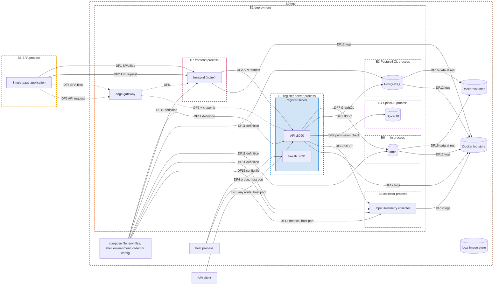

# Threat Model — Application

This model covers the parts of register that run in every deployment: the
server, the single-page application, the frontend's nginx, and the two stores.
It holds every threat that does not depend on how the system is deployed. Four
deployment models build on it, and each lists only what its deployment adds:

| Deployment id | Deployment | Auth mode |
|---|---|---|
| `compose-inmem` | Docker Compose with the `frontend` profile, no `persistence` profile | `capability-only` |
| `compose-persistent` | Docker Compose with the `frontend` and `persistence` profiles and the env file `.env.irmin` | `capability-only` |
| `k3d-L1` | k3d cluster, Layer 1 | `identity` |
| `k3d-L2` | k3d cluster, Layer 2 | `fine-grained` |

How the model is built, and what its terms and diagram conventions mean, is in
[TM-METHODOLOGY-CONCEPTS.md](TM-METHODOLOGY-CONCEPTS.md). Assumptions and
observations about single components are in
[APPLICATION-TM-NOTE.md](APPLICATION-TM-NOTE.md).

The model describes the system at the version and commit stated on the
`**Assessed:**` line above the diagram in §3. A control that does not exist yet
appears as a mitigation with status `open`, never as a boundary.

The model covers the running system. Building the images is outside it: the
sources a build fetches from, and how they are pinned, are governed by ADR-020.
The test stacks are outside it too: `docker-compose.server-it.yml` and the BATS
runner start their own containers for a test run. The development workflow is
outside it as well. The Vite dev server and the SPA's development build exist
only there. The SPA in this model is the production build, which nginx serves
and which calls the API on its own origin
([Constants.scala](../../../modules/app/src/main/scala/app/core/Constants.scala)).

The auth mode is `register.auth.mode` in
[application.conf](../../../modules/server/src/main/resources/application.conf).
Compose does not set `REGISTER_AUTH_MODE`, so both compose deployments run the
default, `capability-only`. The layers are defined in
[AUTHORIZATION-PLAN.md](../plans/AUTHORIZATION-PLAN.md).

---

## 1. Schema

Each threat is one YAML block under its own heading, and the heading repeats
`id` and `label`. A deployment model refers to a threat here by its `id`.

```yaml
# Fields per threat entry:
#   id              - stable identifier, never renamed. T1–T4 keep the ids they
#                     have in THREAT-CATALOG-(INCOMPLETE).md; new threats continue
#                     from T5.
#   label           - name of the threat, the same as its section heading
#   stride          - list; each one of: spoofing | tampering | repudiation |
#                     information-disclosure | denial-of-service |
#                     elevation-of-privilege
#   flow            - id of the data flow the threat acts on (§2.5), or null
#                     for a threat against an element itself
#   element         - name of the element the threat acts on (§2.1), or null
#                     for a threat against a data flow
#   statement       - one sentence: "A <threat source> with <prerequisites> can
#                     <threat action>, which leads to <threat impact>, negatively
#                     impacting <impacted assets>."
#   invariant       - the condition that must hold, stated positively
#   failure_mode    - what happens when the invariant does not hold
#   mitigations     - ordered list; each item has:
#                       control         - what the control does
#                       adr             - the decision record and section that
#                                         require it, or null
#                       implemented_in  - repository-relative path of the code or
#                                         manifest that implements it, or null
#                                         while the control does not exist
#                       test            - repository-relative path of the test
#                                         that proves it, or null
#   status          - map from every deployment id to one of:
#                       mitigated-tested   - a control exists and a test proves it
#                       mitigated-untested - a control exists and no test proves it
#                       accepted           - left open on purpose; `adr` of a
#                                            mitigation names the record saying so
#                       open               - no control exists
#                       not-applicable     - the deployment has no element the
#                                            threat needs
#                       not-assessed       - the control would sit in the
#                                            deployment's own elements, and that
#                                            deployment's model has not assessed
#                                            it yet
#   triage          - the description stage 7 writes for an open threat, or
#                     null for a threat that is open in no deployment:
#                       loss            - the kinds of loss, each tied to an
#                                         asset of §2.2
#                       attempted_by    - the threat source and what it needs
#                                         first, per deployment
#                       in_the_way      - each control an attempt must get
#                                         past, and whether it stops attempts
#                                         one by one or works or fails as a
#                                         whole
#   decision        - the user's ruling on an open threat: fix, accept or
#                     route, with what it names; null until ruled
#   related_code    - list of repository-relative paths directly involved
#   todo            - outstanding work, or null
```

A path in another repository is written with that repository's name first, for
example `register-infra/infra/k8s/gateway/clienttrafficpolicy.yaml`.

---

## 2. Inventory

### 2.1 Elements

The compose elements are read from
[docker-compose.yml](../../../docker-compose.yml), one per service, and the
k3d elements from the register-infra repository.

| Element | What it is | Where it runs |
|---|---|---|
| Single-page application | Scala.js and Laminar, served as static files | the user's browser |
| frontend | nginx. Serves the SPA files and `/config.json`, and in compose passes API requests on to register-server | compose; a pod in k3d |
| register-server | The ZIO, Tapir and zio-http backend, compiled as a GraalVM native image | always |
| Irmin | Content-addressed store for risk trees and their history, read and written over GraphQL | `persistence` profile in compose; a pod in k3d |
| PostgreSQL | Workspace records: the key's SHA-256 hash and the workspace's trees | `persistence` profile in compose; a pod in k3d |
| SpiceDB | Answers permission checks in `fine-grained` mode. Its elements and controls are in the k3d Layer 2 model | a pod in k3d, Layer 2 |
| OpenTelemetry collector | Receives the server's spans and metrics over OTLP. Its `debug` exporter prints traces and metrics to its stdout, and its `prometheus` exporter serves metrics on port 8889 | `observability` profile in compose |
| API client | Any HTTP client on a network that reaches the host | outside the host |
| Host process | Any process an account on the host runs, such as `curl` or a monitoring probe. It reaches the published ports without leaving the host | the host |
| edge gateway | Envoy Gateway. Its elements and controls are in the k3d models | k3d |
| Docker host and daemon | Runs every container. Holds their environment, volumes and logs, and can exec into any container | the host |
| Docker log store | The daemon's store of each container's stdout and stderr, read with `docker logs` | the host |
| Docker volumes `irmin-data` and `pg-data` | Named volumes that hold Irmin's store and PostgreSQL's data directory | the host, with the `persistence` profile |
| Compose file and env files | `docker-compose.yml`, `.env`, `.env.irmin` and `.env.inmemory`, together with the shell environment of whoever runs `docker compose`. They define every container: its image, command, environment, mounts, published ports and hardening options. `otel-collector-config.yaml` is mounted into the collector as a file | the host |
| Local image store | The images the daemon creates the containers from, named on each service's `image:` line. An image fixes its process's entrypoint, default command, default environment, user and filesystem | the host |
| Docker embedded DNS | The daemon's resolver at 127.0.0.11, an address fixed by Docker, inside each container. It resolves the service names `register-server`, `irmin`, `postgres` and `otel-collector` | the host's daemon, reached from each container |

The `persistence` profile starts Irmin and PostgreSQL. register-server uses
them only when its environment says so: `.env.irmin` sets
`REGISTER_REPOSITORY_TYPE=irmin` and `REGISTER_WORKSPACE_STORE_BACKEND=postgres`.
[DOCKER-DEVELOPMENT.md](../../user/DOCKER-DEVELOPMENT.md): "`--profile
persistence` alone leaves the server on its in-memory defaults". Without both,
register-server keeps trees and workspaces in its own memory.

### 2.2 Assets

| Asset | Why it matters | Where it is defined |
|---|---|---|
| Workspace key (`WorkspaceKeySecret`) | A **secret**: holding it is permission to use the workspace. 128 bits from `SecureRandom`, base64url-encoded to 22 characters. Only its SHA-256 hash is stored | ADR-021 §1–2, ADR-022, [TERMINOLOGY.md](../../user/TERMINOLOGY.md) §8.2 |
| Risk trees, their history and their scenarios | The customer's risk analysis | ADR-017, ADR-021 |
| Simulation results: loss exceedance curves and cached values | Derived from the risk trees, and as confidential as they are | no record classifies them |
| Confidential identifier (workspace identifier) | Holding it grants nothing. It never crosses to the client | ADR-036, [TERMINOLOGY.md](../../user/TERMINOLOGY.md) §8.3, §8.7 |
| Resource names (tree, node and mitigation identifiers) | Cross to the client in both directions, and may appear in a server log | [TERMINOLOGY.md](../../user/TERMINOLOGY.md) §8.4, §8.7 |
| Database credentials | `REGISTER_DB_USER` and `REGISTER_DB_PASSWORD` | ADR-022 |
| SpiceDB token (`SPICEDB_TOKEN`) | Read only in `fine-grained` mode | ADR-022, AUTHORIZATION-PLAN L2.2 |
| User identity (`x-user-id`) | Decoded into `UserId.Authenticated`. In `identity` and `fine-grained` mode the application reads it as already validated by the edge | ADR-012 §7 |
| Container logs | Hold whatever each container writes to stdout and stderr. ADR-022: "Secrets must never appear in logs or error messages" | ADR-022 |
| Docker volumes `irmin-data` and `pg-data` | Hold the risk trees and the workspace records at rest, unencrypted, readable from the host | [docker-compose.yml](../../../docker-compose.yml) |
| Simulation capacity | register-server's CPU and memory. Bounded by `maxRequestBytes` (8 MiB, enforced in `Application.scala`) and the container's limits of 2 CPUs and 256 MiB. `maxConcurrentSimulations` (4) is configured and no server code reads it ([APPLICATION-TM-NOTE.md](APPLICATION-TM-NOTE.md)) | `application.conf`, `docker-compose.yml` |

### 2.3 Entry points

The routes come from the endpoint definitions in
`modules/common/src/main/scala/com/risquanter/register/http/endpoints/` and from
`HealthProbeServer`.

| Route | Credential the application checks | Source |
|---|---|---|
| `POST /workspaces` | none. It creates the credential | `WorkspaceLifecycleEndpoints.bootstrapWorkspaceEndpoint` |
| `/w/{key}/...`: trees, history, revert, structure, changed nodes, analysis, query, scenarios, rotate, delete | the workspace key in the path. `x-user-id` is read as an optional header | `BaseEndpoint.authedBaseEndpoint`, `BaseEndpoint.workspaceRoute` |
| `GET /w/{key}/events/tree/{treeId}` | the workspace key in the path, resolved once when the stream opens. A server-sent event stream of the tree's change events, with a heartbeat every 30 seconds | `SSEEndpoints`, `SSEController`, both in the server module |
| `POST /distribution/preview` | none. `x-user-id` is read as an optional header | `DistributionPreviewEndpoints`, `BaseEndpoint.authedBaseEndpoint` |
| `DELETE /admin/workspaces/expired` | none in the application. The controller takes the system maintenance token, and the edge decides who can reach the route | `WorkspaceLifecycleController.evictExpired`; AUTHORIZATION-PLAN L1.5 |
| `GET /health` on port 8090 | none | `SystemEndpoints` |
| `GET /health` and `GET /ready` on port 8091 | none | `HealthProbeServer` |
| `/docs` | none. The Swagger UI | `HttpApi` |

Port 8090 serves the API, and port 8091 serves health probes. The frontend's
nginx passes `/w/*` (unless `Accept` contains `text/html`), `/workspaces`,
`/distribution`, `/health` and `/docs` on to register-server. It does not pass
on `/admin`. The routing is in the nginx template in
[Dockerfile.frontend-prod](../../../containers/prod/Dockerfile.frontend-prod).

### 2.4 Trust boundaries

A trust boundary, in the component sense of
[TM-METHODOLOGY-CONCEPTS.md](TM-METHODOLOGY-CONCEPTS.md) §4, encloses one or
more elements, and a control separates the principals inside it from those
outside. Shostack: "A trust boundary indicates separation of principals by some
control, and the boundary is instantiated by the control." A boundary is drawn
only where its control exists, and boundaries nest. A data flow that crosses a
boundary is where a threat can act.

Every process of the deployment has its own boundary. Its control is process
isolation: in compose, the container's own process, filesystem and namespaces.
Process isolation protects a process's memory and execution. It does not decide
who can call the process's ports. §2.6 records who can.

This model draws only the boundaries whose control is the same in every
deployment where the element exists. A boundary whose control differs between
compose and k3d is drawn in the deployment models. The settings that harden a
container are listed for compose. The k3d settings are in the k3d models.

| Id | Encloses | Control | Where it exists |
|---|---|---|---|
| B1 | The deployment: everything the operator runs | compose: the `register-network` bridge network, opened by every port published on the host. k3d: the cluster network, entered through the edge gateway | all |
| B2 | The register-server process | process isolation. ADR-039 §1: "the trust region is the memory of one process". The image runs as uid 65532 on a distroless base with no shell. Compose sets `read_only`, `no-new-privileges`, and limits of 2 CPUs and 256 MiB | all |
| B3 | The PostgreSQL process | process isolation, and password authentication of `REGISTER_DB_USER`. Compose sets no hardening | `compose-persistent`, k3d |
| B4 | The SpiceDB process | process isolation, and the preshared token `SPICEDB_TOKEN` | `k3d-L2` |
| B5 | The single-page application's process in the browser | the browser's process and origin isolation. ADR-039 §1 names it as the second trust region | all |
| B6 | The Irmin process | process isolation. The image runs as uid 65532. Compose sets `read_only`, `no-new-privileges` and a 10 MiB `/tmp` | `compose-persistent`, k3d |
| B7 | The frontend (nginx) process | process isolation. The image runs as uid 101, and compose sets `read_only`, `no-new-privileges` and a 10 MiB `/tmp` | all |
| B8 | The OpenTelemetry collector process | process isolation. Compose sets no hardening | `observability` profile in compose |
| B9 | The host: B1, the Docker daemon with its embedded DNS, the Docker log store, the Docker volumes, the local image store, and the compose file and env files | the host operating system's accounts and file permissions, and the access rule on the daemon's socket. The repository sets none of them ([APPLICATION-TM-NOTE.md](APPLICATION-TM-NOTE.md)) | `compose-inmem`, `compose-persistent` |

B2, B3, B4, B6, B7 and B8 lie inside B1. In compose, B1 lies inside B9. The
Docker daemon with its embedded DNS, the Docker log store, the Docker volumes,
the local image store, and the compose file and env files are inside B9 and
outside B1. A host process is inside B9. B5 and the API
client lie outside B9. The k3d models give the cluster's equivalent of B9. The
model takes the host's kernel and the Docker daemon as correct
([APPLICATION-TM-NOTE.md](APPLICATION-TM-NOTE.md)).

### 2.5 Data flows

A flow is listed once, in the direction of the request, and its response
travels the same path back. "Ingress point" is the place ADR-039 §1 names where
a value from the flow enters the server process, and is empty for flows that do
not reach it.

| Id | From → to | Carries | Transport | Crosses | Ingress point | Deployments |
|---|---|---|---|---|---|---|
| DF1 | SPA → frontend | requests for the SPA files and `/config.json` | HTTP, host port 18080 | B5, B9, B1, B7 | — | compose |
| DF2 | SPA or API client → frontend → register-server | API requests, workspace key in the path | HTTP, host port 18080, then HTTP on `register-network` | B5, B9, B1, B7, B2 | Tapir codec, JSON decoder, typed claim-header input | compose |
| DF3 | API client or host process → register-server, host port 8090 | API requests, workspace key in the path, any route including `/admin` | HTTP | B9, B1, B2 | Tapir codec, JSON decoder, typed claim-header input | compose |
| DF4 | any host process → register-server, host port 8091 | health and readiness probes | HTTP | B1, B2 | — | compose |
| DF5 | SPA or API client → edge gateway → frontend | requests for the SPA files and `/config.json`, browser navigation | see the k3d models | B5, B1, B7 | — | k3d |
| DF6 | SPA or API client → edge gateway → register-server | API requests, workspace key in the path; the gateway adds `x-user-id` | see the k3d models | B5, B1, B2 | Tapir codec, JSON decoder, typed claim-header input | k3d |
| DF7 | register-server → Irmin | GraphQL reads and writes of risk trees | HTTP on `register-network` | B2, B6 | the repository's decode of a stored value | `compose-persistent`, k3d |
| DF8 | register-server → PostgreSQL | workspace records, and at startup the Flyway schema migrations, both as `REGISTER_DB_USER` | JDBC over TCP. Compose configures no TLS | B2, B3 | the row-to-record conversion | `compose-persistent`, k3d |
| DF9 | register-server → SpiceDB | permission checks | see the k3d models | B2, B4 | the response parse | `k3d-L2` |
| DF10 | register-server → OpenTelemetry collector | spans and metrics | OTLP over gRPC, `http://otel-collector:4317` | B2, B8 | — (outbound only) | when the collector runs |
| DF11 | compose file, env files and the caller's shell environment → every compose container | each container's definition at startup: image, command, environment, mounts, published ports and hardening options. Command: the collector gets `--config=/etc/otel-collector-config.yaml`, and the other four run their image's command (DF19). Environment: Irmin and the collector get none. register-server: its settings and `REGISTER_DB_PASSWORD`. frontend: `BACKEND_URL`, `REGISTER_REPOSITORY_TYPE`, `APP_VERSION` and `REGISTER_DEBUG_UI`, which its entrypoint writes into `nginx.conf` and `/config.json`. PostgreSQL: `POSTGRES_DB`, `POSTGRES_USER` and `POSTGRES_PASSWORD` | `docker compose` reads the compose file, fills each `${…}` from its caller's shell environment and from `.env` or the file named by `--env-file`, and sends the definitions to the Docker daemon over its socket. The daemon starts each process with them | B1, B2, B7, B3, B6, B8 | the config decoder | compose. The k3d models give the cluster's equivalent |
| DF12 | frontend, register-server, Irmin, PostgreSQL and collector → Docker log store | stdout and stderr: nginx's access log in its `masked` format and its error log at `crit`; register-server's log, which names storage paths holding the workspace identifier and tree identifiers; Irmin's and PostgreSQL's own logs; the collector's `debug` exporter output | the Docker daemon | B7, B2, B6, B3, B8, B1 | — | compose |
| DF13 | any host process → OpenTelemetry collector, host ports 8888 and 8889 | metrics reads | HTTP | B1, B8 | — | `observability` profile in compose |
| DF15 | `otel-collector-config.yaml` → OpenTelemetry collector | the collector's configuration | a bind mount of the host file. The mount is not read-only | B1, B8 | — | `observability` profile in compose |
| DF16 | Irmin → volume `irmin-data`; PostgreSQL → volume `pg-data` | the risk trees and the workspace records at rest | the container's filesystem, on a named volume. Unencrypted | B6, B3, B1 | — | `compose-persistent` |
| DF17 | register-server and frontend → Docker embedded DNS | lookups of the service names | DNS to 127.0.0.11. nginx reads the resolver's address from `/etc/resolv.conf` at startup | B2, B7, B1 | — | compose |
| DF18 | Docker daemon → frontend, Irmin, PostgreSQL | the healthcheck command of each service, run inside the container: `wget` to 127.0.0.1 in the frontend and Irmin, `pg_isready` in PostgreSQL | exec by the daemon | B1, B7, B6, B3 | — | compose |
| DF19 | local image store → every compose container | what the image fixes for its process: entrypoint, default command, default environment, user and filesystem. Irmin: `irmin graphql --port 8080 --address 0.0.0.0 --root /data`, as uid 65532. register-server: `REGISTER_FLYWAY_MIGRATIONS_LOCATION`, as uid 65532. frontend: its entrypoint script and nginx template, as uid 101. PostgreSQL and the collector: what their upstream images set | the daemon creates the container from the image named on the service's `image:` line | B1, B2, B7, B3, B6, B8 | the config decoder | compose |

In compose, a client can send `x-user-id` on DF2 and DF3. The decoder checks
that it is a UUID. In `capability-only` mode only no-op services receive it
(`UserContextExtractor.noOp`, `BootstrapProvisionerNoOp`,
`AuthorizationServiceNoOp`), so it has no effect. In k3d the frontend has no
connection to register-server: the gateway routes API paths to register-server
itself (register-infra `docs/plans/PLAN-EGC-ENVOY-GATEWAY-CLUSTER.md` §3.1).

### 2.6 What each boundary admits

The diagram shows the flows that were designed to cross a boundary. It cannot
show what else the boundary's control lets through. This table records that.
"Admits" is every principal that can get past the control. "Designed crossings"
is the flows of §2.5 that cross it. Where the first is wider than the second,
the difference is reachable without a designed flow, and each such row is a
source of threat entries in §4.

The compose columns are recorded here. The k3d columns belong to the k3d
models, because their controls are the cluster's.

| Boundary | Admits in `compose-inmem` | Admits in `compose-persistent` | Designed crossings | Wider than designed |
|---|---|---|---|---|
| B1 | Anything that reaches the host on a published port: 8090 and 8091 (register-server), 18080 (frontend), 4317, 4318, 8888 and 8889 (collector, `observability` profile). The port mappings in [docker-compose.yml](../../../docker-compose.yml) name no host address, so Docker publishes them on every host interface | as `compose-inmem`, plus 9080 (Irmin) and 5432 (PostgreSQL) | DF1, DF2, DF3, DF4, DF5, DF6, DF11, DF12, DF13, DF15, DF16, DF17, DF18, DF19 | yes. Ports 9080 and 5432 have no designed flow from outside B1, and the collector's ports 4317 and 4318 have none |
| B2 | On 8090, every route from every element of B1 and from anything that reaches the host port (row B1), including `DELETE /admin/workspaces/expired`, which checks no credential. On 8091, the probe routes | as `compose-inmem` | DF2, DF3, DF4, DF6, DF7, DF8, DF9, DF10, DF11, DF12, DF17, DF19 | yes. The `/admin` route has no designed caller outside the operator, and nothing in compose restricts who calls it |
| B3 | — (PostgreSQL does not run) | Every element of B1, and anything that reaches host port 5432 (row B1), that presents user `register_app` with its password. The password is the fixed value `dev-only-password`, written in `docker-compose.yml` | DF8, DF11, DF12, DF16, DF18, DF19 | yes. Only register-server is designed to connect, and the password is public in the repository |
| B4 | — (SpiceDB does not run) | — (SpiceDB does not run) | DF9 | — |
| B5 | Scripts and connections from any origin. Neither `modules/app/index.html` nor the frontend's nginx sends a `Content-Security-Policy`. register-server's policy (`default-src 'self'; script-src 'self'; style-src 'self' 'unsafe-inline'; connect-src 'self'`) applies only to responses register-server writes, and the SPA's HTML is not one of them | as `compose-inmem` | DF1, DF2, DF5, DF6 | yes. The SPA is designed to load scripts and call APIs only on its own origin |
| B6 | — (Irmin does not run) | On 8080, every element of B1, with no credential. On host port 9080, anything that reaches the host port (row B1) | DF7, DF11, DF12, DF16, DF18, DF19 | yes. Only register-server is designed to call Irmin, and any caller can read and rewrite every risk tree |
| B7 | On 8080, every element of B1. On host port 18080, anything that reaches the host port (row B1) | as `compose-inmem` | DF1, DF2, DF5, DF11, DF12, DF17, DF18, DF19 | no. The frontend is the public entry, and every caller it admits is one it is designed to serve |
| B8 | On 4317 and 4318, every element of B1 and anything that reaches the host ports (row B1), with no credential. On 8888 and 8889, anything that reaches the host ports | as `compose-inmem` | DF10, DF11, DF12, DF13, DF15, DF19 | yes. Only register-server is designed to send telemetry, and any caller can send spans and metrics |
| B9 | From the network: anything that reaches a published port (row B1). The repository configures no host firewall. On the host: root, and every account the daemon's socket admits. Through the daemon such an account reads each container's definition, including its environment, reads its logs and volumes, runs commands inside it, and starts a container with any host path mounted. Every account that can write the checkout can change the compose file, the env files and the collector's configuration, and every account that can read it can read the env files | as `compose-inmem` | DF1, DF2, DF3 | yes. From the network, as row B1. On the host, only the operator is designed to change the configuration and to call the daemon. Which other accounts can is the host's configuration ([APPLICATION-TM-NOTE.md](APPLICATION-TM-NOTE.md)) |

---

## 3. Data-flow diagram

Each dashed box is a trust boundary from §2.4, drawn in its own colour, and
each arrow is a data flow from §2.5. Between the client side and the server,
solid arrows are compose flows and dotted arrows are k3d flows. The flows out of
register-server are drawn solid, and the Deployments column of §2.5 says where
each one exists. The solid box inside B2 is the register-server component, and
its two ports are where the flows end. Who can reach a process without a drawn
flow is read from §2.6.

**System version:** 0.26.2
**Assessed:** version 0.25.0 · commit c8bbcf70 · stage 6



The API client also sends DF2 and DF6, and a host process also sends DF3. DF17, the name lookups, DF18, the
daemon's healthchecks, and DF19, the image's defaults, touch every compose
container. Those arrows are left out to keep the diagram readable. B9 exists in
compose only, so the edge gateway and SpiceDB, which run in k3d, are not on the
host it encloses. The deployment models draw only the elements and flows of
their own deployment.

---

## 4. Threats

The STRIDE pass covers the compose deployments. It asked the STRIDE classes of
the elements in §2.1, the flows in §2.5 that cross a boundary, and the rows of
§2.6 marked "wider than designed". §4.1 records every answer, and §4.2 holds the
entries. T4 comes from
[THREAT-CATALOG-(INCOMPLETE).md](../THREAT-CATALOG-(INCOMPLETE).md), because the
sentinel user is part of the application. T1–T3 concern the edge, and they move
to the k3d models. The elements and flows that exist only in k3d (the edge
gateway, SpiceDB, DF5, DF6 and DF9) are assessed in the k3d models.

Three rules hold for every entry:

- A unit test or an sbt integration test runs in no deployment. Where such a
  test is the only proof of a control, the entry names it and the compose status
  is `mitigated-untested`.
- An entry whose controls do not all exist has status `open`.
- A k3d status is given only where the control is in the application's own code
  or image. Otherwise it is `not-assessed`.

### 4.1 Coverage

Each cell is a threat id, or "none" with the reason and its source. The classes
asked of each kind of element are those of
[TM-METHODOLOGY-CONCEPTS.md](TM-METHODOLOGY-CONCEPTS.md) §9. Irmin and
PostgreSQL are asked as processes, which is the wider set, because each has a
process boundary and a listening port.

**Elements**

| Element (kind) | S | T | R | I | D | E |
|---|---|---|---|---|---|---|
| Single-page application (process) | T6 | T6, T15 | T17 | T15. Key in the address bar: none, path routing is the design (`WorkspaceState.scala`) | none: static files, no shared state | T15 |
| frontend (process) | T6 | none: `read_only`, uid 101, configuration written once at start | T17 | T5. Version: none, `server_tokens off` | T8 | none for its own privileges: uid 101, `no-new-privileges`, and it does not pass `/admin` on. T7, T11 and T12 start from any element of B1 |
| register-server (process) | T6 for the client's view of the server. Key guessing: none, 16 bytes of `SecureRandom` (`WorkspaceKeyCrypto.scala`) | T11, T12 for its stored state. Request content: none, codecs refine at ingress (ADR-039) | T17 | T14, T16. Key in its log: none (`RequestSpanInterceptor.spanName`) | T8, T9, T10 | T7, T16. Container privileges: none, uid 65532, distroless, `read_only`, `no-new-privileges` |
| Irmin (process and store) | T11 | T11 | T17 | T11 | T11 | T11 |
| PostgreSQL (process and store) | T12 | T12 | T17 | T12 | T12, T9 | T20 |
| OpenTelemetry collector (process) | T13 | T13 | T13 | T14 | T13 | T21 |
| API client (external) | none: holding the key is the identity (ADR-021) | n/a | T17 | n/a | n/a | n/a |
| Host process (external) | T7 for `/admin`. Probes: none, constant answers (`HealthProbeServer.scala`) | n/a | T17 | n/a | n/a | n/a |
| Docker host and daemon (process) | none: taken as correct | none: same | none: same | T22 | none: same | T22 |
| Docker log store (store, logs) | n/a | none: only the daemon writes it | none: same | T5, T14, T22 | T23 | n/a |
| Docker volumes (store) | n/a | T22. Through the processes: T11, T12 | n/a | T22 | T8 | n/a |
| Compose file and env files (store) | n/a | T22, T21 | n/a | T22. Database password: none, it is public (`docker-compose.yml`) | none: read once at `up` | n/a |
| Local image store (store) | n/a | T18 | n/a | none: no Dockerfile bakes a secret in | none: needs the daemon, T22 | n/a |
| Docker embedded DNS (process) | none: part of the daemon, taken as correct | none: same | none: same | none: service names are not secret | none: same | none: same |

**Flows that cross a boundary**

| Flow | T | I | D |
|---|---|---|---|
| DF1 | T6 | T6 for a navigation to `/w/{key}`. The SPA files and `/config.json`: none, no secret in them | T8 |
| DF2 | T6, T19 | T6, T19, T5 | T8, T10 |
| DF3 | T6 | T6 | T8, T7 |
| DF4 | none: constant answers | none: liveness only | T8 |
| DF7 | T11, T19 | T11, T19 | T11. A slow store: none, 30 s timeout (`application.conf`) |
| DF8 | T12, T19 | T12, T19 | T12, T9 |
| DF10 | T13 | T14, T19 | none: batched asynchronous export (`TelemetryLive.scala`). No test proves it |
| DF11 | T22 | T22 | none: read once at start |
| DF12 | none: daemon taken as correct | T5, T14, T22. Workspace identifier in the server log: none, permitted ([TERMINOLOGY.md](../../user/TERMINOLOGY.md) §8.3) | T23 |
| DF13 | T13 | T13 | T13 |
| DF15 | T21 | none: the file is in the public repository | none: read at start |
| DF16 | T22 | T22 | T8 |
| DF17 | none: the daemon's resolver, taken as correct | none: names are not secret | none: same |
| DF18 | none: fixed commands to 127.0.0.1 | none: the commands carry no secret | none: fixed interval |
| DF19 | T18 | none: images hold no secret | none: needs the daemon |

**Admits rows marked wider than designed**

| Row | S | T | R | I | D | E |
|---|---|---|---|---|---|---|
| B1 | T11, T12, T13 | T11, T12, T13 | T17 | T11, T12, T13 | T11, T12, T13 | T7, T20 |
| B2 (`/admin`) | T7 | T7 | T17 | none: the answer is one count | T7 | T7 |
| B3 | T12 | T12 | T17 | T12 | T12 | T20 |
| B5 | T15 | T15 | none: the SPA records nothing | T15 | none: per browser | T15 |
| B6 | T11 | T11 | T17 | T11 | T11 | T11 |
| B8 | T13 | T13 | T13 | T14 | T13 | T21 |
| B9 | from the network, as B1 | T22 | T22 | T22 | T22 | T22 |

### 4.2 Entries

### T5: Workspace key written to the frontend's logs

```yaml
id: T5
label: Workspace key written to the frontend's logs
stride: [information-disclosure]
flow: DF12
element: null
statement: >
  A person or tool that can read the container logs, holding no workspace key,
  can read workspace keys from the frontend's access log and error log, which
  leads to full use of every workspace whose key was logged, negatively
  impacting the risk trees, scenarios and simulation results of those
  workspaces.
invariant: No log line written by any component contains a workspace key.
failure_mode: >
  The SPA routes by path (ADR-025), so every workspace URL holds the key:
  /w/{key}/... . nginx's default `combined` access-log format writes the request
  line, which holds the key, and the Referer header, which holds the key on
  every request a page under /w/{key} makes. nginx's error log, at levels error
  and warn, writes the request line when a call to register-server fails. A log
  configuration that falls back to either default writes the key: in compose for
  browser navigation and for every API request the frontend passes on, in k3d
  for browser navigation, which the gateway routes to the frontend.
mitigations:
  - control: >
      The access log uses the `masked` format, which replaces the segment after
      /w/ in the request line and records no Referer. The error log runs at
      crit, which records no request line
    adr: ADR-022 ("Secrets must never appear in logs or error messages")
    implemented_in: containers/prod/Dockerfile.frontend-prod
    test: tests/bats/suite-a-full-prod.bats
status:
  compose-inmem: mitigated-tested
  compose-persistent: mitigated-tested
  k3d-L1: mitigated-untested
  k3d-L2: mitigated-untested
triage: null
decision: null
related_code:
  - containers/prod/Dockerfile.frontend-prod
todo: null
```

The control is in the frontend image, so every deployment runs it. Test A08 in
suite A runs the image in compose, where it sends a proxied request with the key
in its path and its Referer, a browser navigation, and a request while
register-server is stopped, and then finds the key nowhere in the frontend's
log. The nginx configuration does not depend on the `persistence` profile, so
the test covers both compose deployments. No test runs the image in k3d.

### T4: Sentinel UUID Exclusion from SpiceDB

```yaml
id: T4
label: Sentinel UUID Exclusion from SpiceDB
stride: [elevation-of-privilege, spoofing]
flow: null
element: register-server
statement: >
  A caller with a route to register-server that lets it set x-user-id to
  00000000-0000-0000-0000-000000000000, in a deployment whose SpiceDB holds a
  relationship for that subject, can pass permission checks as the sentinel
  user, which leads to the access those relationships grant, negatively
  impacting the risk trees and workspaces the relationships name.
invariant: >
  The sentinel UUID holds no permission in SpiceDB, and no request reaches a
  permission check carrying it.
failure_mode: >
  The x-user-id decoder accepts the all-zero UUID as UserId.Authenticated. In
  capability-only mode the extractor yields the sentinel when the header is
  absent, and AuthorizationServiceNoOp never calls SpiceDB. In fine-grained
  mode a present value is checked as an ordinary subject.
mitigations:
  - control: The edge removes a client-supplied x-user-id before it adds its own
    adr: ADR-012 §7 (T3)
    implemented_in: null
    test: null
  - control: A rule in SpiceDB that refuses the sentinel subject on every check
    adr: ADR-012 §7 (T4)
    implemented_in: null
    test: null
status:
  compose-inmem: not-applicable
  compose-persistent: not-applicable
  k3d-L1: not-assessed
  k3d-L2: not-assessed
triage: null
decision: null
related_code:
  - modules/server/src/main/scala/com/risquanter/register/auth/UserContextExtractor.scala
  - modules/common/src/test/scala/com/risquanter/register/domain/data/iron/AuthTypesSpec.scala
todo: The k3d Layer 2 model decides where the sentinel is refused
```

Compose runs the no-op authorization service and no SpiceDB, so the threat has
no element there. ADR-012 §7 names a caveat `non_sentinel_user`, and
`register-infra/infra/spicedb` holds no caveat.

### T6: No transport encryption on the host's published ports

```yaml
id: T6
label: No transport encryption on the host's published ports
stride: [information-disclosure, tampering, spoofing]
flow: DF2
element: null
statement: >
  A party on the network path between a client and the host, holding no
  workspace key, can read and alter every request and response on host ports
  18080 and 8090, which leads to capture of workspace keys and to altered SPA
  files and API answers, negatively impacting the workspace keys and the risk
  trees, scenarios and simulation results of those workspaces.
invariant: >
  A workspace key, and the SPA files that handle it, cross a network only
  inside an encrypted and authenticated channel.
failure_mode: >
  Compose serves DF1, DF2 and DF3 as plain HTTP on every host interface. The
  key is in the path of each API request and of each browser navigation to
  /w/{key}. A client cannot tell the frontend or register-server from an
  impostor. register-server sends Strict-Transport-Security on its /w and
  /workspaces answers, and a browser ignores that header over HTTP.
mitigations:
  - control: TLS on every entry a client uses
    adr: 'ADR-021 §4 ("HTTPS-only: Prevents URL sniffing on the wire")'
    implemented_in: null
    test: null
  - control: Publish the ports on 127.0.0.1 only
    adr: null
    implemented_in: null
    test: null
status:
  compose-inmem: open
  compose-persistent: open
  k3d-L1: not-assessed
  k3d-L2: not-assessed
triage:
  loss: >
    The workspace keys of every client whose traffic the party sees, and through
    them the risk trees, scenarios and simulation results of those workspaces.
    Altered SPA files extend the loss to the keys of every later visitor.
  attempted_by: >
    A party on the network path between a client and the host, such as a shared
    LAN or Wi-Fi network, in both compose deployments. A client on the host
    itself has no such path.
  in_the_way: >
    Nothing as built. TLS would work or fail as a whole. Publishing the ports on
    127.0.0.1 would remove the network path as a whole, and leave only clients
    on the host.
decision: null
related_code:
  - docker-compose.yml
  - containers/prod/Dockerfile.frontend-prod
  - modules/server/src/main/scala/com/risquanter/register/http/SecurityHeadersInterceptor.scala
todo: null
```

The entry covers DF1 and DF3 as well as DF2. Whether a host's interfaces face a
hostile network is that host's fact.

### T7: Admin eviction route answers any caller

```yaml
id: T7
label: Admin eviction route answers any caller
stride: [elevation-of-privilege, denial-of-service, spoofing]
flow: null
element: register-server
statement: >
  A caller that reaches register-server on port 8090, from any element of B1 or
  through the host port, holding no credential, can call DELETE
  /admin/workspaces/expired as often as it likes, which leads to operator
  maintenance run by a non-operator and to repeated full reads of the workspace
  store, negatively impacting simulation capacity and the workspace records.
invariant: Only the operator can start an eviction sweep.
failure_mode: >
  evictExpiredEndpoint is built on baseEndpoint and takes no credential. The
  controller takes the system maintenance token and checks nothing about the
  caller. On the PostgreSQL backend each call reads every workspaces row and
  builds a record for each. The sweep deletes only workspaces already past a
  deadline.
mitigations:
  - control: The frontend does not pass /admin on
    adr: null
    implemented_in: containers/prod/Dockerfile.frontend-prod
    test: null
  - control: An enforcement point that admits only the operator to /admin
    adr: null
    implemented_in: null
    test: null
status:
  compose-inmem: open
  compose-persistent: open
  k3d-L1: not-assessed
  k3d-L2: not-assessed
triage:
  loss: >
    Simulation capacity, through repeated full reads of the workspace store. The
    sweep deletes only workspaces already past their deadline, so no workspace a
    user still holds is lost.
  attempted_by: >
    Any caller that reaches port 8090, through the host port or from any element
    of B1, with no credential, in both compose deployments.
  in_the_way: >
    The frontend does not pass /admin on. It works as a whole and covers only
    callers on port 18080. Nothing stands in the way on port 8090.
decision: null
related_code:
  - modules/common/src/main/scala/com/risquanter/register/http/endpoints/WorkspaceLifecycleEndpoints.scala
  - modules/server/src/main/scala/com/risquanter/register/http/controllers/WorkspaceLifecycleController.scala
  - modules/server/src/main/scala/com/risquanter/register/services/workspace/WorkspaceStorePostgres.scala
  - docker-compose.yml
todo: null
```

Host port 8090 reaches the route directly, so the frontend's routing protects
only callers that come through port 18080. No test asserts that routing.

### T8: No entry limits the request rate of one caller

```yaml
id: T8
label: No entry limits the request rate of one caller
stride: [denial-of-service]
flow: DF2
element: null
statement: >
  A caller that reaches host port 18080 or 8090, holding no workspace key, can
  send POST /workspaces and POST /distribution/preview without limit, which
  leads to memory, storage and CPU exhaustion, negatively impacting simulation
  capacity, the Docker volumes and, in compose-inmem, every workspace held in
  register-server's memory.
invariant: The state and the work an anonymous caller can cause are bounded per caller.
failure_mode: >
  POST /workspaces creates a workspace and a tree from up to 8 MiB of request
  body per call, and nothing counts calls. In compose-inmem the records and
  trees live in a container limited to 256 MiB with restart unless-stopped, so
  exhaustion ends in a restart that loses every workspace. In
  compose-persistent the trees go to the irmin-data volume. The nginx template
  holds no limit_req and no limit_conn, and the frontend service has no
  resource limit.
mitigations:
  - control: Request body cap of 8 MiB
    adr: ADR-017 §6
    implemented_in: modules/server/src/main/scala/com/risquanter/register/Application.scala
    test: modules/server-it/src/test/scala/com/risquanter/register/http/RequestBodyLimitItSpec.scala
  - control: The reaper deletes expired workspaces and their trees
    adr: ADR-021
    implemented_in: modules/server/src/main/scala/com/risquanter/register/services/workspace/WorkspaceReaper.scala
    test: modules/server/src/test/scala/com/risquanter/register/services/workspace/WorkspaceReaperSpec.scala
  - control: >
      A rate limit per client address at the component that holds the client's
      connection: the frontend's nginx in compose, which does not cover host
      port 8090, and the Envoy Gateway in k3d
    adr: ADR-021 §4
    implemented_in: null
    test: null
status:
  compose-inmem: open
  compose-persistent: open
  k3d-L1: not-assessed
  k3d-L2: not-assessed
triage:
  loss: >
    Simulation capacity. In compose-persistent, space on the irmin-data volume.
    In compose-inmem, every workspace held in register-server's memory, lost
    when the container restarts at its 256 MiB limit.
  attempted_by: >
    Any caller that reaches host port 18080 or 8090, with no workspace key, in
    both compose deployments.
  in_the_way: >
    The 8 MiB body cap stops each request one by one at a size, and does not
    count requests. The reaper removes a workspace after its deadline, as a
    whole. No rate limit exists.
decision: null
related_code:
  - modules/server/src/main/scala/com/risquanter/register/http/controllers/WorkspaceLifecycleController.scala
  - containers/prod/Dockerfile.frontend-prod
  - docker-compose.yml
todo: null
```

ADR-021 §4: "**This is a known, unclosed gap:** no rate limit exists at the
gateway today, so workspace creation is currently unbounded." Compose has no
gateway. Whether Irmin frees space after a delete is not checked.

### T9: One request exhausts the seed-entity counter

```yaml
id: T9
label: One request exhausts the seed-entity counter
stride: [denial-of-service]
flow: null
element: register-server
statement: >
  A caller that can send POST /workspaces, holding no workspace key, can create
  one workspace with seedEntityId=99999999, which leads to every later creation
  that omits seedEntityId failing, negatively impacting the availability of
  workspace creation for every user.
invariant: No caller-chosen value can move the shared assignment counter to its end.
failure_mode: >
  A provided seedEntityId moves the counter past itself. The in-memory store
  sets nextSeedEntityId to the provided value plus one, and SeedEntityId refuses
  100000000 on each later assignment. The PostgreSQL store runs setval on
  workspace_seed_entity_id_seq, whose MAXVALUE is 99999999, so the state
  survives restarts and the eviction of the workspace that caused it. The SPA
  creates workspaces without a seedEntityId.
mitigations:
  - control: A counter that a provided value cannot advance, or a provided range kept apart from the assigned range
    adr: null
    implemented_in: null
    test: null
status:
  compose-inmem: open
  compose-persistent: open
  k3d-L1: open
  k3d-L2: open
triage:
  loss: >
    The availability of workspace creation for every user who omits
    seedEntityId, which includes every user of the SPA. On PostgreSQL the state
    outlives a restart and the eviction of the workspace that caused it, until
    the sequence is reset by hand. In memory it lasts until register-server
    restarts.
  attempted_by: >
    Any caller that can send POST /workspaces, with one request and no workspace
    key, in every deployment that admits that route.
  in_the_way: >
    Nothing. Checked against local/register-server:0.25.0: a create with
    seedEntityId=99999999 answered 201, and every later create without it
    answered 503 on PostgreSQL, also after a restart, and 500 in memory.
decision: null
related_code:
  - modules/server/src/main/scala/com/risquanter/register/services/workspace/WorkspaceStoreLive.scala
  - modules/server/src/main/scala/com/risquanter/register/services/workspace/WorkspaceStorePostgres.scala
  - modules/server/src/main/resources/db/migration/V2__workspace_seed_entity_id.sql
  - modules/common/src/main/scala/com/risquanter/register/http/endpoints/WorkspaceLifecycleEndpoints.scala
todo: null
```

The behaviour was run against `local/register-server:0.25.0` on both stores.
After one such create, `workspace_seed_entity_id_seq` stood at 99999999. The
in-memory store answers the later creates with 500, a defect rather than a typed
failure. In k3d the caller needs whatever the edge requires for
`POST /workspaces`.

### T10: Nothing bounds the simulations in flight

```yaml
id: T10
label: Nothing bounds the simulations in flight
stride: [denial-of-service]
flow: null
element: register-server
statement: >
  A caller holding one workspace key can send many analysis and query requests
  at once and open any number of event streams, which leads to CPU and memory
  exhaustion in register-server, negatively impacting simulation capacity for
  every other workspace.
invariant: The work one caller keeps in flight is bounded, and so is the total.
failure_mode: >
  maxConcurrentSimulations is configured as 4 and no server code reads it. The
  resolver fans out across a portfolio's children with an unbounded foreachPar.
  Application.scala sets no request timeout. SSEHub caps no subscriber count.
  The container's limits of 2 CPUs and 256 MiB are the only bound.
mitigations:
  - control: Limits on nodes, children, mitigations and trees per workspace
    adr: ADR-017 §6
    implemented_in: modules/common/src/main/scala/com/risquanter/register/domain/data/RiskTree.scala
    test: modules/common/src/test/scala/com/risquanter/register/domain/data/RiskTreeBoundsSpec.scala
  - control: Container limits of 2 CPUs and 256 MiB
    adr: null
    implemented_in: docker-compose.yml
    test: null
  - control: A cap on concurrent node resolution, read from maxConcurrentSimulations
    adr: null
    implemented_in: null
    test: null
status:
  compose-inmem: open
  compose-persistent: open
  k3d-L1: open
  k3d-L2: open
triage:
  loss: >
    Simulation capacity for every workspace. In compose-inmem, every workspace
    in memory when the container restarts at its 256 MiB limit.
  attempted_by: >
    A caller holding one workspace key. Creation is anonymous (T8), so any
    caller can hold one.
  in_the_way: >
    The ADR-017 bounds on nodes, children, mitigations and trees stop each
    request one by one at a size. The container's limits work as a whole.
    Nothing caps the work in flight.
decision: null
related_code:
  - modules/server/src/main/resources/application.conf
  - modules/server/src/main/scala/com/risquanter/register/services/cache/CachedResultResolverLive.scala
  - modules/server/src/main/scala/com/risquanter/register/services/sse/SSEHub.scala
  - docker-compose.yml
todo: docs/dev/plans/PLAN-SIMULATION-CONCURRENCY-BOUNDS.md connects the configured value
```

The k3d status covers the application's own missing cap. The cluster's limits
belong to the k3d models.

### T11: Irmin serves any caller with no credential

```yaml
id: T11
label: Irmin serves any caller with no credential
stride: [spoofing, tampering, information-disclosure, denial-of-service, elevation-of-privilege]
flow: null
element: Irmin
statement: >
  A caller that reaches Irmin on port 8080 from any element of B1, or on host
  port 9080 from anything that reaches the host, holding no workspace key, can
  read, rewrite and delete every stored value and branch over GraphQL, which
  leads to disclosure, alteration and loss of every workspace's data, negatively
  impacting the risk trees, their history and their scenarios.
invariant: Only register-server can call Irmin.
failure_mode: >
  The image runs irmin graphql on 0.0.0.0:8080 with no authentication, and
  register-server sends no credential. Compose publishes the port as 9080 on
  every host interface. The storage paths hold the workspace identifier, so a
  caller also learns every confidential identifier.
mitigations:
  - control: Do not publish port 9080, or publish it on 127.0.0.1 only
    adr: null
    implemented_in: null
    test: null
  - control: A control that admits only register-server to Irmin's port
    adr: null
    implemented_in: null
    test: null
status:
  compose-inmem: not-applicable
  compose-persistent: open
  k3d-L1: not-assessed
  k3d-L2: not-assessed
triage:
  loss: >
    The confidentiality, integrity and existence of every workspace's risk
    trees, history and scenarios, and every workspace identifier.
  attempted_by: >
    In compose-persistent, any element of B1 on port 8080, and anything that
    reaches host port 9080. No credential is needed.
  in_the_way: >
    Nothing.
decision: null
related_code:
  - docker-compose.yml
  - containers/prod/Dockerfile.irmin-prod
  - modules/server/src/main/scala/com/risquanter/register/infra/irmin/IrminClientLive.scala
  - tests/bats/suite-a-full-prod.bats
todo: null
```

Suite A reads Irmin on `http://localhost:9080/graphql` with no credential, which
shows the read path as built. A write from outside register-server has not been
exercised.

### T12: PostgreSQL accepts a password that is public

```yaml
id: T12
label: PostgreSQL accepts a password that is public
stride: [spoofing, tampering, information-disclosure, denial-of-service]
flow: null
element: PostgreSQL
statement: >
  A caller that reaches PostgreSQL on port 5432 from any element of B1, or on
  host port 5432 from anything that reaches the host, knowing the password
  written in the repository, can log in as register_app and read and rewrite
  the workspace records, which leads to takeover of any workspace by replacing
  its key hash and to deletion of any workspace, negatively impacting the
  workspace keys, the workspace records and the risk trees they give access to.
invariant: Only register-server can log in to PostgreSQL.
failure_mode: >
  docker-compose.yml sets POSTGRES_PASSWORD to dev-only-password and publishes
  port 5432 on every host interface. A logged-in caller can set
  workspaces.key_hash to the SHA-256 of a key it chose, and that key then
  resolves to the victim's workspace. It can also delete rows and move
  workspace_seed_entity_id_seq to its end (T9). The stored hashes are of 128-bit
  random keys and do not yield the keys.
mitigations:
  - control: A password taken from the environment, with no default in the compose file
    adr: ADR-022
    implemented_in: null
    test: null
  - control: Do not publish port 5432, or publish it on 127.0.0.1 only
    adr: null
    implemented_in: null
    test: null
  - control: Only the SHA-256 hash of a workspace key is stored
    adr: ADR-021 §1–2
    implemented_in: modules/server/src/main/scala/com/risquanter/register/services/workspace/WorkspaceKeyCrypto.scala
    test: modules/server/src/test/scala/com/risquanter/register/services/workspace/WorkspaceKeyCryptoSpec.scala
status:
  compose-inmem: not-applicable
  compose-persistent: open
  k3d-L1: not-assessed
  k3d-L2: not-assessed
triage:
  loss: >
    Every workspace, taken over by replacing its key hash or deleted, together
    with the risk trees its key gives access to. The role is a superuser, so the
    loss widens to T20.
  attempted_by: >
    In compose-persistent, any element of B1 on port 5432, and anything that
    reaches host port 5432, knowing the password written in docker-compose.yml.
  in_the_way: >
    Password authentication works as a whole. Checked against
    postgres:17-alpine: pg_hba.conf ends in host all all all scram-sha-256, and
    a wrong password from another container is refused. The password is public,
    so the control stops nobody who reads the repository. Storing only the key's
    hash stops reading a key, not replacing one.
decision: null
related_code:
  - docker-compose.yml
  - modules/server/src/main/scala/com/risquanter/register/services/workspace/WorkspaceStorePostgres.scala
  - modules/server/src/main/resources/db/migration/V1__workspace_schema.sql
todo: null
```

The takeover is read from the code, which resolves a key by `key_hash` alone,
and has not been run. The image demands the password from other containers:
`pg_hba.conf` ends in `host all all all scram-sha-256`.

### T13: The collector accepts telemetry from any caller

```yaml
id: T13
label: The collector accepts telemetry from any caller
stride: [spoofing, tampering, repudiation, denial-of-service, information-disclosure]
flow: null
element: OpenTelemetry collector
statement: >
  A caller that reaches the collector on ports 4317 or 4318 from any element of
  B1 or through the host ports, holding no credential, can send spans and
  metrics under any service name and at any rate, which leads to false
  telemetry served on port 8889 and to unbounded output on the collector's
  stdout, negatively impacting the container logs and the trust placed in the
  metrics.
invariant: Only register-server can send telemetry, and only the operator can read it.
failure_mode: >
  otel-collector-config.yaml binds both OTLP receivers to 0.0.0.0 with no
  authentication, and compose publishes 4317, 4318, 8888 and 8889 on every host
  interface. The pipelines hold a batch processor and no memory limiter, and
  the service has no resource limit. Forged data cannot be told from
  register-server's. Anyone who reaches 8889 reads the metrics.
mitigations:
  - control: Do not publish 4317 and 4318, and publish 8888 and 8889 on 127.0.0.1 only
    adr: null
    implemented_in: null
    test: null
  - control: Receiver authentication, a memory limiter and a container resource limit
    adr: null
    implemented_in: null
    test: null
status:
  compose-inmem: open
  compose-persistent: open
  k3d-L1: not-applicable
  k3d-L2: not-applicable
triage:
  loss: >
    The integrity of the metrics served on port 8889, the container logs through
    the debug exporter's output, and the collector's memory.
  attempted_by: >
    While the observability profile runs: any element of B1, and anything that
    reaches host ports 4317, 4318, 8888 and 8889, with no credential.
  in_the_way: >
    Nothing. What port 8889 serves is still unchecked. The check needs
    register-server to send telemetry, and no register-server image at the
    current version is in the local image store.
decision: null
related_code:
  - otel-collector-config.yaml
  - docker-compose.yml
todo: null
```

The threat exists only while the `observability` profile runs. What the metrics
on port 8889 hold has not been read. The check is
`curl http://localhost:8889/metrics` with the profile up.

### T14: Query text leaves register-server in span attributes

```yaml
id: T14
label: Query text leaves register-server in span attributes
stride: [information-disclosure]
flow: DF10
element: null
statement: >
  A person or tool that can read the collector's output or the traffic to it,
  holding no workspace key, can read the text of users' queries and the tree
  and node identifiers of their requests, which leads to disclosure of what a
  customer asks of its risk model, negatively impacting the risk trees and the
  container logs.
invariant: A span carries no content a customer wrote.
failure_mode: >
  QueryServiceLive sets the span attribute query.text to the submitted query.
  RiskTreeServiceLive sets tree_id, node_id and node_ids. The exporter sends
  them over OTLP without TLS. The collector's traces pipeline exports to debug,
  which prints to stdout and so to the Docker log store.
mitigations:
  - control: The span name holds the route family and never the workspace key
    adr: ADR-021
    implemented_in: modules/server/src/main/scala/com/risquanter/register/http/RequestSpanInterceptor.scala
    test: modules/server/src/test/scala/com/risquanter/register/http/RequestSpanInterceptorSpec.scala
  - control: No customer-written text in a span attribute
    adr: null
    implemented_in: null
    test: null
status:
  compose-inmem: open
  compose-persistent: open
  k3d-L1: not-assessed
  k3d-L2: not-assessed
triage:
  loss: >
    The confidentiality of what customers ask of their risk models, and their
    resource names.
  attempted_by: >
    While the observability profile runs: an account that can read the container
    logs (T22), or a party that sees DF10 (T19).
  in_the_way: >
    Reading the container logs needs the daemon's socket, which works as a
    whole. Nothing in register-server keeps query text out of a span. Whether
    the debug exporter prints attributes is still unchecked, for the reason
    given in T13.
decision: null
related_code:
  - modules/server/src/main/scala/com/risquanter/register/services/QueryServiceLive.scala
  - modules/server/src/main/scala/com/risquanter/register/services/RiskTreeServiceLive.scala
  - modules/server/src/main/scala/com/risquanter/register/telemetry/TelemetryLive.scala
  - otel-collector-config.yaml
todo: null
```

Whether the `debug` exporter at `verbosity: normal` prints attributes is not
verified. The check is one query with the profile up, then
`docker logs otel-collector`. No decision record classifies query text. Tree and
node identifiers are resource names, which a log may hold.

### T15: The SPA document carries no Content-Security-Policy

```yaml
id: T15
label: The SPA document carries no Content-Security-Policy
stride: [tampering, information-disclosure, elevation-of-privilege]
flow: null
element: Single-page application
statement: >
  An attacker who gets script to run in the SPA's page, through a flaw in the
  SPA or one of its bundled libraries, can read the workspace key from the URL
  and send it to any origin, which leads to full use of that workspace,
  negatively impacting the workspace key and the risk trees, scenarios and
  simulation results of the workspace.
invariant: >
  The SPA's page loads script only from its own origin and connects only to its
  own origin.
failure_mode: >
  nginx answers the SPA shell with X-Content-Type-Options and Cache-Control
  only, and modules/app/index.html holds no policy. register-server's policy is
  on its own answers, which do not include the HTML. Nothing in the browser
  stops an injected script or limits where it connects.
mitigations:
  - control: A Content-Security-Policy on every response nginx generates
    adr: null
    implemented_in: null
    test: null
  - control: Free text is confined to permitted characters at the Iron boundary
    adr: ADR-029 §1
    implemented_in: modules/common/src/main/scala/com/risquanter/register/domain/data/iron/OpaqueTypes.scala
    test: null
status:
  compose-inmem: open
  compose-persistent: open
  k3d-L1: not-assessed
  k3d-L2: not-assessed
triage:
  loss: >
    One workspace key per successful injection, and that workspace's risk trees,
    scenarios and simulation results.
  attempted_by: >
    An attacker with a flaw that injects script into the SPA, in its code or a
    bundled library. The STRIDE pass found no such flaw.
  in_the_way: >
    The Iron character limits on free text stop each value one by one. No
    Content-Security-Policy limits an injected script.
decision: null
related_code:
  - containers/prod/Dockerfile.frontend-prod
  - modules/app/index.html
  - modules/server/src/main/scala/com/risquanter/register/http/SecurityHeadersInterceptor.scala
todo: null
```

The pass found no path that injects script. The entry records the missing
second line of defence. The k3d models say whether the gateway adds a policy.

### T16: An open event stream outlives its workspace key

```yaml
id: T16
label: An open event stream outlives its workspace key
stride: [elevation-of-privilege, information-disclosure]
flow: null
element: register-server
statement: >
  A former key holder with an event stream opened while the key was valid can
  keep the stream open after the key is rotated or the workspace expires, which
  leads to continued receipt of change events for that tree, negatively
  impacting the confidentiality of the workspace's activity and its resource
  names.
invariant: A rotated or expired key grants nothing from the moment it stops resolving.
failure_mode: >
  SSEController resolves the key once, when the stream opens. The stream is the
  hub subscription merged with a 30-second heartbeat, and nothing checks the key
  again or ends the stream on rotate, delete or expiry.
mitigations:
  - control: Rotation replaces the stored hash, so the old key resolves to nothing on new requests
    adr: ADR-021
    implemented_in: modules/server/src/main/scala/com/risquanter/register/services/workspace/WorkspaceStoreLive.scala
    test: modules/server/src/test/scala/com/risquanter/register/services/workspace/WorkspaceStoreSpec.scala
  - control: End every stream of a workspace when its key is rotated, deleted or expired
    adr: null
    implemented_in: null
    test: null
status:
  compose-inmem: open
  compose-persistent: open
  k3d-L1: open
  k3d-L2: open
triage:
  loss: >
    The confidentiality of a workspace's change activity and resource names
    after its key stops resolving.
  attempted_by: >
    A former key holder with an event stream opened before rotation or expiry,
    through an API client. The SPA opens no stream.
  in_the_way: >
    Rotation stops every new request with the old key, as a whole. Nothing ends
    a stream that is already open.
decision: null
related_code:
  - modules/server/src/main/scala/com/risquanter/register/http/sse/SSEController.scala
  - modules/server/src/main/scala/com/risquanter/register/services/sse/SSEHub.scala
todo: null
```

The SPA opens no event stream, so only an API client reaches this today. What an
event carries is not verified here beyond the stream's existence.

### T17: No record ties an action to a caller

```yaml
id: T17
label: No record ties an action to a caller
stride: [repudiation]
flow: null
element: register-server
statement: >
  A key holder, or a caller of a store's open port, can change or delete a
  workspace's data and later deny it, which leads to changes nobody can
  attribute, negatively impacting the risk trees, their history and the
  workspace records.
invariant: Each change to a workspace is recorded with enough to tell who made it.
failure_mode: >
  Every caller is anonymous in capability-only mode. The frontend's access log
  carries the client address and masks the key, so its lines cannot be matched
  to a workspace. A call on host port 8090 passes no access log. Every Irmin
  commit carries the fixed author zio-client. A change made through T11 or T12
  leaves no line in register-server's log.
mitigations:
  - control: Security events for create, delete, rotate and evict, with the workspace identifier
    adr: null
    implemented_in: modules/server/src/main/scala/com/risquanter/register/services/workspace/WorkspaceStore.scala
    test: null
  - control: Irmin keeps each tree's commit history
    adr: null
    implemented_in: modules/server/src/main/scala/com/risquanter/register/infra/irmin/IrminClientLive.scala
    test: null
  - control: A record of the caller's address or identity beside each change
    adr: null
    implemented_in: null
    test: null
status:
  compose-inmem: open
  compose-persistent: open
  k3d-L1: not-assessed
  k3d-L2: not-assessed
triage:
  loss: >
    The ability to attribute a change to a risk tree or a workspace record, and
    with it the investigation of any other threat.
  attempted_by: >
    Any key holder, and any caller of an open store port (T11, T12).
  in_the_way: >
    The security events for create, delete, rotate and evict record the
    workspace and no caller. Irmin's history records the fixed author zio-
    client. Neither ties a change to a caller.
decision: null
related_code:
  - modules/server/src/main/scala/com/risquanter/register/services/workspace/WorkspaceStorePostgres.scala
  - modules/server/src/main/scala/com/risquanter/register/infra/irmin/IrminClientLive.scala
  - containers/prod/Dockerfile.frontend-prod
todo: null
```

In `compose-inmem` no commit history exists. That register-server's own log
lines carry no client address is not verified line by line.

### T18: Two runtime images are named by a tag alone

```yaml
id: T18
label: Two runtime images are named by a tag alone
stride: [tampering, elevation-of-privilege]
flow: DF19
element: null
statement: >
  A party that can change what a registry serves for a tag, holding no access
  to the host, can replace the image behind postgres:17-alpine or
  otel/opentelemetry-collector-contrib:0.95.0, which leads to code of its choice
  running inside B1 with the database's data or the telemetry, negatively
  impacting the workspace records and every element the container can reach.
invariant: Every image a container starts from is fixed by digest.
failure_mode: >
  docker-compose.yml names both images by tag with no digest. The daemon pulls
  whatever the tag resolves to when the image is absent from the local image
  store. Neither service sets read_only, no-new-privileges or a resource limit.
mitigations:
  - control: A tag plus a digest on each image line
    adr: 'ADR-020 §1 ("A specific semver tag plus a digest. Never `:latest`, and never a tag alone.")'
    implemented_in: null
    test: null
status:
  compose-inmem: open
  compose-persistent: open
  k3d-L1: not-assessed
  k3d-L2: not-assessed
triage:
  loss: >
    The workspace records and the telemetry, and code of the attacker's choice
    inside B1.
  attempted_by: >
    A party that controls what a registry serves for postgres:17-alpine or the
    collector's tag, at a moment the image is absent from the local image store,
    such as a first pull or after a prune.
  in_the_way: >
    An image already in the local image store is reused, which works as a whole
    until it is removed. No digest fixes the image.
decision: null
related_code:
  - docker-compose.yml
todo: null
```

In `compose-inmem` only the collector's image applies, and only with the
`observability` profile. The three images built from `containers/prod/` pin
their bases by digest.

### T19: A compromised container can intercept traffic inside the deployment

```yaml
id: T19
label: A compromised container can intercept traffic inside the deployment
stride: [information-disclosure, tampering]
flow: DF2
element: null
statement: >
  An attacker who controls one container on register-network, holding no
  workspace key, can place itself between two other containers, which leads to
  reading and altering the unencrypted flows between them, negatively impacting
  the workspace keys, the risk trees and the workspace records.
invariant: A container sees only the traffic addressed to it.
failure_mode: >
  The second leg of DF2, and DF7, DF8 and DF10, are unencrypted on one bridge
  network. No service in docker-compose.yml sets cap_drop. The second leg of
  DF2 carries the workspace key in its path, and DF7 carries the risk trees.
mitigations:
  - control: Drop the NET_RAW capability from every service
    adr: null
    implemented_in: null
    test: null
  - control: Encrypt the flows between containers
    adr: null
    implemented_in: null
    test: null
status:
  compose-inmem: open
  compose-persistent: open
  k3d-L1: not-assessed
  k3d-L2: not-assessed
triage:
  loss: >
    As the statement: the workspace keys on the second leg of DF2, and the risk
    trees on DF7.
  attempted_by: >
    An attacker who controls a container process and also gains root inside that
    container. Checked against the local images: postgres runs as uid 70, nginx
    as 101, Irmin and register-server as 65532, and each process's effective
    capability set is empty. The postgres image holds no setuid file. Answering
    address lookups for a neighbour needs NET_RAW in the effective set. The
    collector's image runs as uid 10001.
  in_the_way: >
    The non-root user works as a whole. no-new-privileges, which compose sets on
    register-server, the frontend and Irmin, works as a whole. The absence of
    setuid files in the postgres image works as a whole.
decision: null
related_code:
  - docker-compose.yml
todo: null
```

Every container keeps `NET_RAW` in its bounding set, because no service sets
`cap_drop`. The processes run as non-root users with an empty effective set, so
the threat needs root inside a container first. The collector's image sets
`User` to 10001 (`docker inspect`).

### T20: PostgreSQL's one role administers the database

```yaml
id: T20
label: PostgreSQL's one role administers the database
stride: [elevation-of-privilege, tampering]
flow: null
element: PostgreSQL
statement: >
  A caller logged in as register_app, through T12 or through a compromised
  register-server, can change the schema and use every right the role holds,
  which leads to control of the database beyond the workspace records,
  negatively impacting the workspace records and the Docker volume pg-data.
invariant: The role register-server works with can read and write rows and nothing more.
failure_mode: >
  Compose creates one role, POSTGRES_USER register_app. application.conf gives
  register.flyway.user and register.db.dataSource.user the same variable, so
  the role that serves requests also owns and migrates the schema. The postgres
  service sets no read_only, no no-new-privileges and no resource limit.
mitigations:
  - control: A migration role separate from an application role limited to rows
    adr: null
    implemented_in: null
    test: null
  - control: read_only, no-new-privileges and a resource limit on the postgres service
    adr: null
    implemented_in: null
    test: null
status:
  compose-inmem: not-applicable
  compose-persistent: open
  k3d-L1: not-assessed
  k3d-L2: not-assessed
triage:
  loss: >
    The workspace records, the pg-data volume, and command execution inside the
    postgres container as uid 70, because a superuser can run COPY ... TO
    PROGRAM.
  attempted_by: >
    Anyone through T12, or an attacker who controls register-server. Checked
    against postgres:17-alpine with compose's settings: register_app is a
    superuser.
  in_the_way: >
    Nothing beyond T12's public password.
decision: null
related_code:
  - docker-compose.yml
  - modules/server/src/main/resources/application.conf
todo: null
```

`register_app` is a superuser. The postgres image creates `POSTGRES_USER` as
one, and `select rolsuper from pg_roles` answered true. The role can therefore
run programs in the container.

### T21: The collector can rewrite its own configuration on the host

```yaml
id: T21
label: The collector can rewrite its own configuration on the host
stride: [tampering, elevation-of-privilege]
flow: DF15
element: null
statement: >
  An attacker who controls the collector process, which takes input from any
  caller (T13), can write to otel-collector-config.yaml in the host's checkout,
  which leads to a configuration of its choice at every later start, negatively
  impacting the compose file and env files and the telemetry.
invariant: No container can write a file that defines a container.
failure_mode: >
  Compose mounts ./otel-collector-config.yaml with no :ro flag. The collector
  service sets no read_only and no no-new-privileges. A rewritten file can add
  an exporter that sends every span to an outside address.
mitigations:
  - control: Mount the file read-only
    adr: null
    implemented_in: null
    test: null
status:
  compose-inmem: open
  compose-persistent: open
  k3d-L1: not-applicable
  k3d-L2: not-applicable
triage:
  loss: >
    The collector's configuration in the host's checkout, and through it every
    later span, which a rewritten exporter can send to an outside address.
  attempted_by: >
    While the observability profile runs: an attacker who controls the collector
    process through a flaw reached by its open receivers (T13).
  in_the_way: >
    The file's mode and owner on the host work as a whole. On this host the file
    is 0664, owned by uid 1000 and gid 989, and the daemon runs with userns-
    remap, so no container uid maps to either. The write therefore fails on this
    host. The collector runs as uid 10001, so on any host the write fails unless
    the file is writable by every account or owned by uid 10001.
decision: null
related_code:
  - docker-compose.yml
  - otel-collector-config.yaml
todo: null
```

Whether the write succeeds depends on the uid the upstream image runs as and on
the file's mode on the host. The image runs as uid 10001, and on this host the
write fails, as `triage` states.

### T22: Every account the daemon's socket admits holds all data and all definitions

```yaml
id: T22
label: Every account the daemon's socket admits holds all data and all definitions
stride: [information-disclosure, tampering, elevation-of-privilege, denial-of-service, repudiation]
flow: null
element: Docker host and daemon
statement: >
  An account on the host that the Docker daemon's socket admits, or that can
  write the checkout, holding no workspace key, can read and change the
  volumes, the container logs, each container's environment and the compose
  and env files, which leads to disclosure and alteration of every workspace
  and to containers started from a changed definition, negatively impacting
  the risk trees, the workspace records, the database credentials and the
  container logs.
invariant: Only the operator's account passes B9's control on the host.
failure_mode: >
  The volumes hold the risk trees and workspace records unencrypted. The daemon
  returns each container's environment, which holds REGISTER_DB_PASSWORD. The
  repository sets no account, no file mode and no socket rule, and nothing in
  it records who used the daemon.
mitigations:
  - control: The host's accounts, its file permissions and the access rule on the daemon's socket
    adr: null
    implemented_in: null
    test: null
status:
  compose-inmem: open
  compose-persistent: open
  k3d-L1: not-assessed
  k3d-L2: not-assessed
triage:
  loss: >
    Every asset the host holds: the risk trees and workspace records on the
    volumes, the container logs, the database password in each container's
    environment, and the definitions of every container.
  attempted_by: >
    An account on the host that the daemon's socket admits, or that can write
    the checkout.
  in_the_way: >
    The host's accounts, file permissions and socket rule work as a whole. The
    repository sets none of them.
decision: null
related_code:
  - docker-compose.yml
  - .gitignore
todo: null
```

The control is the host's and is not in the repository, so the repository can
show no status above `open`. The three checks in
[APPLICATION-TM-NOTE.md](APPLICATION-TM-NOTE.md) settle it on a given host. In
`compose-inmem` no volume exists, and the entry covers the logs, the
environment and the definitions.

### T23: Container logs grow without a configured bound

```yaml
id: T23
label: Container logs grow without a configured bound
stride: [denial-of-service]
flow: DF12
element: null
statement: >
  A caller that reaches any published port, holding no workspace key, can make
  the containers write log lines at the rate it sends requests, which leads to
  the host's disk filling, negatively impacting the container logs, the Docker
  volumes and every container on the host.
invariant: The space the container logs take is bounded.
failure_mode: >
  docker-compose.yml sets no logging options on any service. nginx writes one
  access-log line per request. register-server writes a line per Irmin write.
  The collector's debug exporter prints what it receives from any caller (T13).
mitigations:
  - control: A log driver with a size limit and rotation on each service
    adr: null
    implemented_in: null
    test: null
status:
  compose-inmem: open
  compose-persistent: open
  k3d-L1: not-assessed
  k3d-L2: not-assessed
triage:
  loss: >
    The host's disk, and with it every container and volume on the host.
  attempted_by: >
    Any caller that reaches a published port, at the rate it sends requests.
    While the observability profile runs, any caller of the collector's
    receivers as well.
  in_the_way: >
    Nothing. Checked on this host: the daemon's logging driver is json-file, and
    /etc/docker/daemon.json sets no log-opts.
decision: null
related_code:
  - docker-compose.yml
  - containers/prod/Dockerfile.frontend-prod
  - otel-collector-config.yaml
todo: null
```

A bound may exist in a host daemon's own configuration, which the repository
does not hold. This host sets none.
