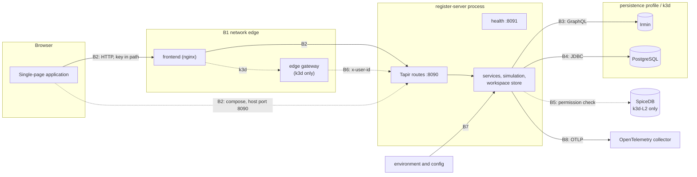

# Threat Model — Application

This model covers the parts of register that run in every deployment: the
server, the single-page application, the frontend's nginx, and the two stores.
It holds every threat that does not depend on how the system is deployed. Four
deployment models build on it, and each lists only what its deployment adds:

| Deployment id | Deployment | Auth mode |
|---|---|---|
| `compose-inmem` | Docker Compose, no `persistence` profile | `capability-only` |
| `compose-persistent` | Docker Compose with the `persistence` profile | `capability-only` |
| `k3d-L1` | k3d cluster, Layer 1 | `identity` |
| `k3d-L2` | k3d cluster, Layer 2 | `fine-grained` |

The auth mode is `register.auth.mode` in
[application.conf](../../../modules/server/src/main/resources/application.conf).
Compose does not set `REGISTER_AUTH_MODE`, so both compose deployments run the
default, `capability-only`. The layers are defined in
[AUTHORIZATION-PLAN.md](../plans/AUTHORIZATION-PLAN.md).

---

## 1. Schema

Each threat is one YAML block under its own heading, and the heading repeats
`id` and `label`. A deployment model refers to a threat here by its `id`.

```yaml
# Fields per threat entry:
#   id              - stable identifier, never renamed. T1–T4 keep the ids they
#                     have in THREAT-CATALOG-(INCOMPLETE).md; new threats continue
#                     from T5.
#   label           - name of the threat, the same as its section heading
#   stride          - list; each one of: spoofing | tampering | repudiation |
#                     information-disclosure | denial-of-service |
#                     elevation-of-privilege
#   boundary        - id of the trust boundary the threat crosses (§2.4)
#   statement       - one sentence: "A <threat source> with <prerequisites> can
#                     <threat action>, which leads to <threat impact>, negatively
#                     impacting <impacted assets>."
#   invariant       - the condition that must hold, stated positively
#   failure_mode    - what happens when the invariant does not hold
#   mitigations     - ordered list; each item has:
#                       control         - what the control does
#                       adr             - the decision record and section that
#                                         require it, or null
#                       implemented_in  - repository-relative path of the code or
#                                         manifest that implements it
#                       test            - repository-relative path of the test
#                                         that proves it, or null
#   status          - map from every deployment id to one of:
#                       mitigated-tested   - a control exists and a test proves it
#                       mitigated-untested - a control exists and no test proves it
#                       accepted           - left open on purpose; `adr` of a
#                                            mitigation names the record saying so
#                       open               - no control exists
#                       not-applicable     - the deployment has no element the
#                                            threat needs
#   related_code    - list of repository-relative paths directly involved
#   todo            - outstanding work, or null
```

A path in another repository is written with that repository's name first, for
example `register-infra/infra/k8s/gateway/clienttrafficpolicy.yaml`.

---

## 2. Inventory

### 2.1 Processes and stores

| Element | What it is | Where it runs |
|---|---|---|
| Single-page application | Scala.js and Laminar, served as static files | The user's browser |
| frontend | nginx. Serves the SPA files and `/config.json`, and passes API requests on to register-server | `frontend` profile in compose; a pod in k3d |
| register-server | The ZIO, Tapir and zio-http backend, compiled as a GraalVM native image | Always |
| Irmin | Content-addressed store for risk trees and their history, read and written over GraphQL | `persistence` profile in compose; a pod in k3d |
| PostgreSQL | Workspace records: the key's SHA-256 hash and the workspace's trees | `persistence` profile in compose; a pod in k3d |
| OpenTelemetry collector | Receives the server's spans and metrics over OTLP | `observability` profile in compose |

Without the `persistence` profile, register-server keeps trees and workspaces
in its own memory, and Irmin and PostgreSQL do not run.

### 2.2 Assets

| Asset | Why it matters | Where it is defined |
|---|---|---|
| Workspace key (`WorkspaceKeySecret`) | A **secret**: holding it is permission to use the workspace. 128 bits from `SecureRandom`, base64url-encoded to 22 characters. Only its SHA-256 hash is stored. | ADR-021 §1–2, ADR-022, [TERMINOLOGY.md](../../user/TERMINOLOGY.md) §8.2 |
| Risk trees, their history and their scenarios | The customer's risk analysis | ADR-017, ADR-021 |
| Simulation results: loss exceedance curves and cached values | Derived from the risk trees, and as confidential as they are | no record classifies them |
| Confidential identifiers (`TreeId`, workspace id) | Kept off the wire outside the answers that need them | ADR-036, [TERMINOLOGY.md](../../user/TERMINOLOGY.md) §8.3 |
| Database credentials | `REGISTER_DB_USER` and `REGISTER_DB_PASSWORD` | ADR-022 |
| SpiceDB token (`SPICEDB_TOKEN`) | Read only in `fine-grained` mode | ADR-022, AUTHORIZATION-PLAN L2.2 |
| User identity (`x-user-id`) | Decoded into `UserId.Authenticated`. The application reads it as already validated by the edge. | ADR-012 §7 |

### 2.3 Entry points

The routes come from the endpoint definitions in
`modules/common/src/main/scala/com/risquanter/register/http/endpoints/`.

| Route | Credential the application checks | Source |
|---|---|---|
| `POST /workspaces` | none. It creates the credential | `WorkspaceLifecycleEndpoints.bootstrapWorkspaceEndpoint` |
| `/w/{key}/...`: trees, history, revert, structure, changed nodes, analysis, query, scenarios, rotate, delete | the workspace key in the path. `x-user-id` is read as an optional header | `BaseEndpoint.authedBaseEndpoint`, `BaseEndpoint.workspaceRoute` |
| `POST /distribution/preview` | none | `DistributionPreviewEndpoints` |
| `DELETE /admin/workspaces/expired` | none in the application. The controller takes the system maintenance token, and the edge decides who can reach the route | `WorkspaceLifecycleController.evictExpired`; AUTHORIZATION-PLAN L1.5 |
| `GET /health` | none | `SystemEndpoints` |
| `/docs` | none. The Swagger UI | `HttpApi` |

Port 8090 serves the API, and port 8091 serves health probes. The frontend's
nginx passes `/w/*` (unless `Accept` contains `text/html`), `/workspaces`,
`/distribution`, `/health` and `/docs` on to register-server. It does not pass
on `/admin`. The routing is in the nginx template in
[Dockerfile.frontend-prod](../../../containers/prod/Dockerfile.frontend-prod).

### 2.4 Trust boundaries

ADR-039 §1 places the server's borders where a value enters process memory from
outside, and lists the ingress points. B2–B7 are that list. B1 and B8 are not in
ADR-039. B1 is the network edge in front of the server, and B8 is the server's
outbound telemetry, which carries logs and spans out of the process.

| Id | Crossing | Ingress or egress point |
|---|---|---|
| B1 | Outside network → first hop | compose: ports published on the host. k3d: the edge gateway (see the k3d models) |
| B2 | Browser or API client → server, and server → browser | Tapir codec and JSON decoder, on both sides |
| B3 | Irmin → server | the repository's decode of a stored value |
| B4 | PostgreSQL → server | the row-to-record conversion |
| B5 | SpiceDB → server | the response parse |
| B6 | Edge → server identity header | the typed claim-header input (`x-user-id`) |
| B7 | Environment and configuration → server | the config decoder |
| B8 | Server → telemetry | the OTLP exporter |

B5 exists only in `k3d-L2`. B6 carries an identity only in `k3d-L1` and
`k3d-L2`. In the compose deployments the header is absent, and register-server
uses the anonymous sentinel user.

---

## 3. Data-flow diagram

Each subgraph is one trust region. An arrow that leaves a subgraph crosses the
boundary it is labelled with. Dashed arrows exist only in some deployments.



The diagram shows the application's own flows. Each deployment model draws its
own edge: which ports are published, and which gateway, identity provider and
policy service sit in front of register-server.

---

## 4. Threats

The STRIDE pass over §2.4 has not been run yet, so this section has no entries.
T4 moves here from
[THREAT-CATALOG-(INCOMPLETE).md](../THREAT-CATALOG-(INCOMPLETE).md), because the
sentinel user is part of the application. T1–T3 concern the edge, and they move
to the k3d models.
